This page contains preliminary research notes investigating if the Moon's 12-month year was used to divide the night sky into 12 regions.  As it is a work in progress you will not yet find conclusions on this page.  Each of the 12 region may have represented each of the 12 tribes of Israel.

Helps:
 - Using the horizon line to bisect the ecliptic path of the moon with apparent shapes in the Milky Way.
   - The context of the list of names include Hebrew word-plays and descriptive language which we will demonstrate is describing apparent shapes in the Milky Way.  These shapes in turn create a 12 month calendar system. 
 - The book of Numbers has consistent groupings of 3 (Numbers, 1,2,7,10,26).  Then consistent order for the camp, the offerings, and for travel.  (Numbers 2, 7, 10)
   - The 12 tribes: Judah, Issachar, Zebulun;  Reuben, Simeon, Gad;  Ephraim, Manasseh, Benjamin;  Dan, Asher, Naphtali.
   - The 13th tribe: Levi in the middle of the camp.

Difficulties:
 - The 12 lunar orbits of the moon around earth does not match a solar year of earth's orbit around the sun.
   - Lunar phase-to-phase (synodic months): 365.2422 ÷ 29.5306 ≈ 12.37 lunations per year. This is the count the modern Hebrew calendar uses, and the reason a 12-month lunar year falls about 11 days short and needs a 13th month every 2 to 3 years.
   - Against the stars (sidereal months): 365.2422 ÷ 27.3217 ≈ 13.37 orbits per tropical year. This is the moon's true orbit around the Earth.
 - Due to the precession of the equinoxes the time between Adam and Moses caused the alignment of the seasonal calendar relative to the fixed stars to shift by about 36 days, representing a drift of greater than one calendar month.  
| Year | precession of equinox since Gen 1 | Reference | Notes |
| ---: | ---: |---|---|
| -4382 | 0 | Genesis 1 | Adam narrative approximately around when galactic equator, ecliptic's fall equinox bisect. |
| -2726 | 22 | Genesis 7 | Flood narrative when fall equinox is leaving the last bright colorful region above the milky way: Rho Ophiuchi |
| -2182 | 30 | Genesis 30 | Joseph's birth narrative ( approximate ) |
| -1722 | 36 | Exodus 1 | Exodus Moses narrative ( approximate ) |

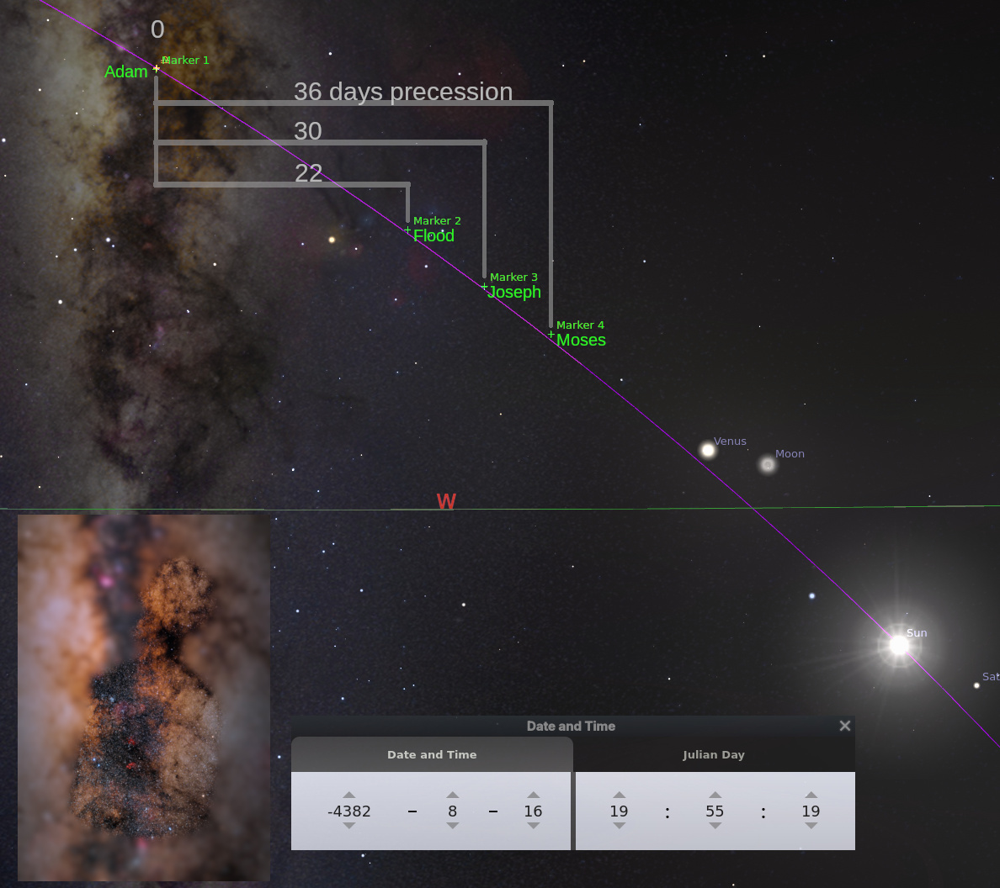
TODO: link to study - in Genesis they are wandering Shepherds, Moses updates the calendar system where 1st month is Exodus/Passover/Spring setting the stage for a calendar optimal for farming the land which was obtained under Joshuah.
 - The transition from sons of Israel to tribes we find:
   - Joseph receives a double portion through two sons: Tribe of Ephraim, and Tribe of Manasseh
   - The Tribe of Levi becomes the priesthood and they dwell in and amongst the other tribes.
   - The order of the names of the sons which later become tribes are not always the same when they are listed.  Sometimes Joseph is included sometimes tribes are missing. This means we have to work out which name order may have also been used as a calendar.  See: [sons & tribes of Israel](https://docs.google.com/spreadsheets/d/1DTLq_eES_UIKtz0zpHqwWa1Yu5Bd5z6NHWqDFZNcCoE/edit?usp=sharing) for full details of the lists.
   - Sometimes there is more than one region that matches a tribal blessing.  Inferring a few things:
     - Not a sequential calendar - but rather just applying apparent shapes observed in night sky as family blessings.
     - Is a sequential calendar - just unclear on which regions.
     - Is a sequential calendar - just not the same order of names as recorded in Numbers.
     - No calendar and no matches.  If you don't see the apparent shapes as matches, then simply do not waste your time on this research.

## Judah (יְהוּדָה)
 - Meaning: praise
 - 1st month (Noah) - Noah's birth month
 - 7th month (Moses)
   - Ethanim (Hebrew) 'ever-flowing stream /or/ steady flowings' 1Kings 8:2
 - Tishri from tasritu 'beginning' (Akkadian)
 - September-October?
 - Feasts: Rosh Hashana (head of the year), Yom Kippur (day of atonement), Sukkoth (tabernacles).
 - Leah's 4th son
 - Jacob's 4th son
 

 There is a classical Hebrew word play on the names of sons of Jacob.  The wordplay's are lost when the Hebrew is translated into other languages.  Judah(יְהוּדָה) means praise(יָדָה), which in turn relates to hand(יָד) as in stretching out your hand in praise. 

---
Leah:
> And she conceived again and bore a son, and said, 
> “Now I-will-praise (יָדָה | אוֹדֶה) the LORD.” 
>  Therefore she called his name Judah (יְהוּדָה). 
>  Then she stopped bearing. Gen 29:35

---
Jacob:
> Judah (יְהוּדָה), your brothers shall praise (יָדָה) you; 
> Your hand (יָד)shall be on the neck of your enemies; 
> Your father’s sons shall bow down to you. 
> Judah (יְהוּדָה) is a lion’s whelp; 
> From the prey, my son, you have gone up. 
> He couches, he lies down as a lion, 
> And as a lion, who dares rouse him up? 
> The scepter shall not depart from Judah, 
> Nor the ruler’s staff from between his feet, 
> Until Shiloh comes, 
> And to him shall be the obedience (יִקָּהָה) of the peoples. 
> He ties his foal to the vine, 
> And his donkey’s colt to the choice vine; 
> He washes his garments in wine (יַיִן) , 
> And his robes in the blood of grapes. 
> His eyes are dull from wine(יַיִן), 
> And his teeth white from milk. 
> Gen 49:8-12 

---
Moses
> And this regarding Judah; so he said,  
> “Hear, O LORD, the voice of Judah, 
> And bring him to his people. 
> With his hands he contended for them, 
> And may You be a help against his adversaries.”
> Deut 33:7

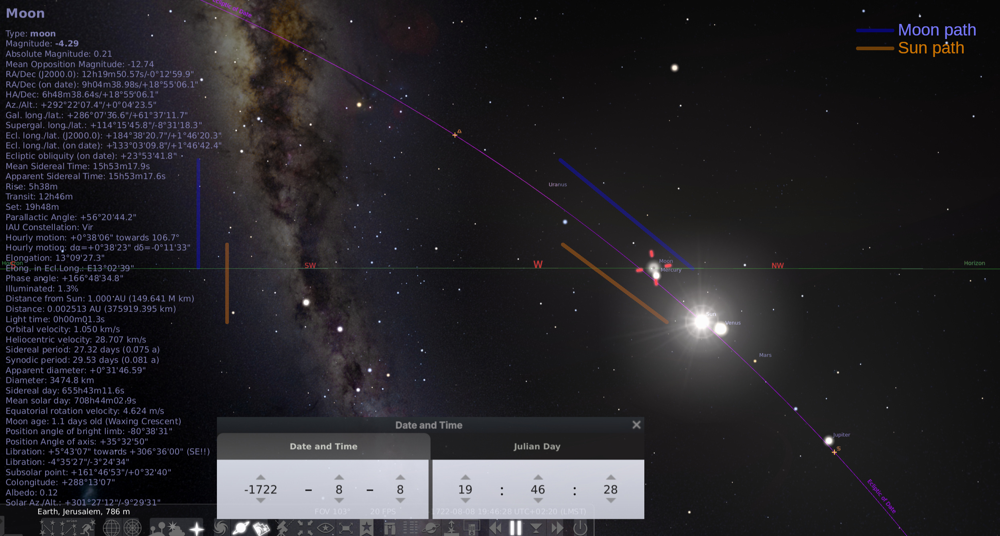
-1722 approximately time of Joseph and Exodus. Moon in the region of the Yod/Hand. The path of the sun represents one lunar month. The path of the moon is start of lunar month to beginning of next lunar month.

To date I've found only 4 apparent shapes of lions in the milky way - See [Appendix A](#appendix-a).  There are 3 tribal blessings that reference lions:
- Lion of Judah by Jacob - Gen 49:9
- Lion of Dan by Moses - Deut 33:22
- Lion of Gad by Moses - Deut 33:20

I choose to start with Judah blessing by Jacob as it references the Yod/Hand shape.

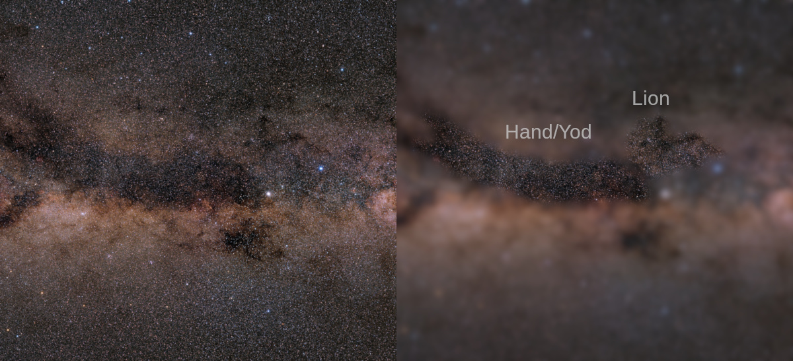
Found but in the wrong calendar region.  Below fits better the lion of Dan, however the vine, donkey and robes could match Judah.
Below clockwise:
- star region
- lion
- foal, donkey's colt, vine
- garments/robes washed in wine/blood of grapes
  - red and purple garments were costly and were worn by royalty so the robes could infer the scepter and rulers staff.

I'm including these difficulties in order to stay honest.  TODO: Investigate if Jacob and Moses ascribed different regions.  As we are using the tribal order of Moses in Numbers I'll try to note the differences.

Leah:
 - praise ( found root word hand ) - found

Jacob:
 - praise/hand - found
 - lion crouches, he lies down as a lion - found
 - donkey - found
 - vine - found
 - garments/robes - found
 - eyes are dull - not found
 - teeth are white - not found

Moses:
 - hands - found

---

## Issachar (יִשָּׂשכָר)  
 - Meaning: wages
 - 2nd month (Noah)
 - 8th month (Moses)
   - Bul uncertain: 'produce/yield or rain/flood' 1Kings 6:38
 - Cheshvan/Marcheshvan 'eighth month' (Akkadian)
 - October-November
 - Feasts: 
 - Leah's 5th son
 - Jacob's 9th son

---

Leah:

> Now Reuben went in the days of wheat harvest and found mandrakes in the field, 
> and brought them to his mother Leah. 
> Then Rachel said to Leah, “Please give me some of your son’s mandrakes.” 
> But she said to her, “Is it a small matter that you have taken away my husband? 
> Would you take away my son’s mandrakes also?” 
> And Rachel said, “Therefore he will lie with you tonight for your son’s mandrakes.” 
> When Jacob came out of the field in the evening, 
> Leah went out to meet him and said, 
> “You must come in to me, for I have surely-hired(שָׂכֹ֣ר שְׂכַרְתִּ֔יךָ) you with my son’s mandrakes.” 
> And he lay with her that night. 
> And God listened to Leah, and she conceived and bore Jacob a fifth son. 
> Leah said, “God has given me my wages(שְׂכָרִ֔י), because I have given my maid to my husband.”
> So she called his name Issachar(יִשָּׂשכָֽר).
> Genesis 30:14-18

In Hebrew the word for "Mandrakes"(דּוּדַי) is very similar to "beloved"(דּוֹד).  See [Appendix B](#appendix-b) for notes on "Mandrakes".

---

Jacob:

> Issachar is a strong donkey, 
> Lying down between two sheepfolds/burdens/sattlebags. 
> “When he saw that a resting place was good 
> And that the land was pleasant, 
> He bowed his shoulder to bear burdens, 
> And became a slave at forced labor. 
> Gen 49:14-15

---

Moses combines Zebulun and Issachar referring to them as "they will":

> Of Zebulun he said, 
> “Rejoice, Zebulun, in your going forth, 
> And, Issachar, in your tents.  
> They will call peoples to the mountain;  
> There they will offer righteous sacrifices;  
> For they will draw out the abundance of the seas,  
> And the hidden treasures of the sand." 
> Deut 33:18-18

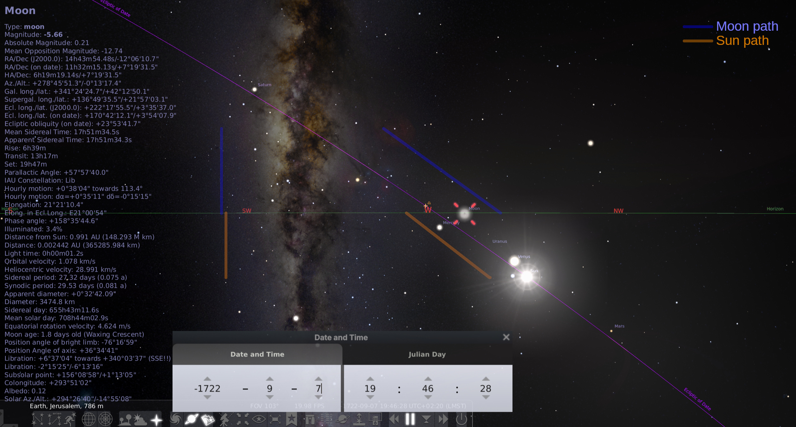
Calendar Month

Base Image

2 Donkeys

Servant

Wages were weighed out in balance scales.  
> Then I said to them, 
> “If it is agreeable to you, give me my-wages(שְׂכָרִ֖י); and if not, refrain.” 
> So they weighed out for my-wages(שְׂכָרִ֖י) thirty pieces of silver. 
> Zechariah 11:12

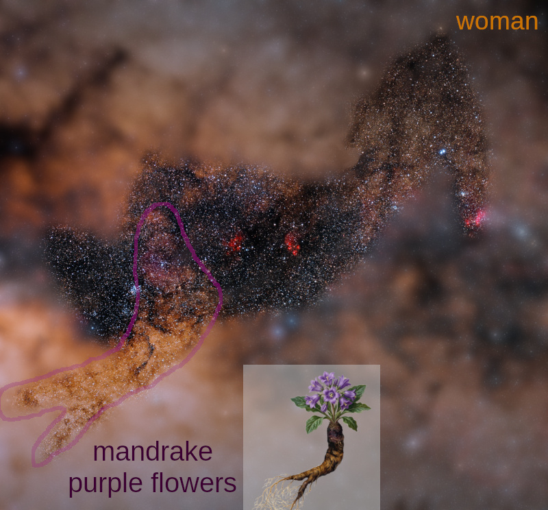
Woman and Mandrakes

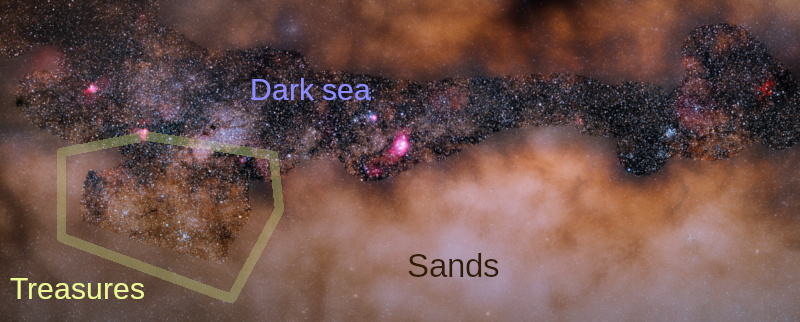
Treasures of the sand - shared with Zebulun

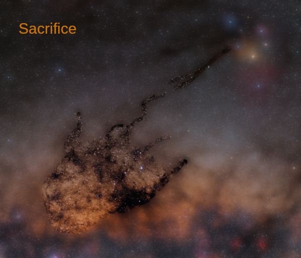
Mountain and Sacrifices - shared with Zebulun

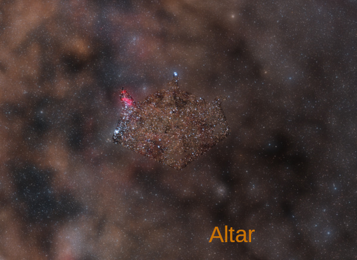
Altar - shared with Zebulun

Leah:
 - wages - found scales
 - mandrakes - found

Jacob:
 - strong donkey between two sheeflolds/burdens - found
 - bear burdens - found
 - slave at forced labor - found

Moses combines Zebulun and Issachar:
 - tents - not found
 - mountain & sacrifices - found
 - 2nd altar - found
 - draw out of abundance of the seas - found
 - hidden treasures of the sand - found

---

## Zebulun
 - Meaning: dwelling 
 - 3rd month (Noah)
 - 9th month (Moses)
 - Kislev
 - November-December
 - Feasts: Hanukkah (dedication of temple at time of Maccabees)
 - Leaah's 6th son
 - Jacob's 10th son

---

Leah:

> And Leah said, “God has endowed me with a good endowment; 
> now my husband will-dwell-with-me(יִזְבְּלֵנִי), because I have borne him six sons.” 
> So she called his name Zebulun(זְבֻלוּן).
> Gen 30:20

---

Jacob:

> Zebulun will dwell at the *seashore*; 
> And he shall be a *haven for ships*, 
> And his flank shall be toward Sidon. 
> Gen 49:13

---

Moses:

> Of Zebulun he said, 
> “Rejoice, Zebulun, in your going forth, 
> And, Issachar, in your tents.  
> They will call peoples to the mountain;  
> There they will offer righteous sacrifices;  
> For they will draw out the abundance of the seas,  
> And the hidden treasures of the sand." 
> Deut 33:18-18

---

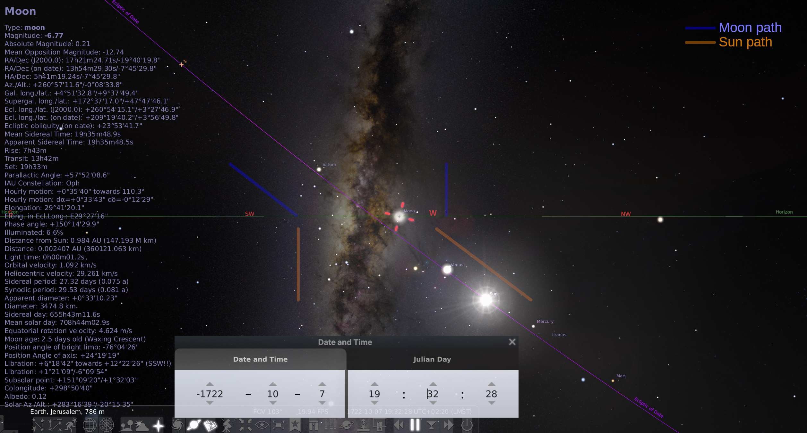
Calendar Region

Base Image - shared with Issacar

Treasures of the sand haven or inlet for ships. Ships may be the white sails. - shared with Issacar

Mountain and Sacrifices - shared with Issacar

Altar - shared with Issacar

Leah:
- dwell - too difficult to find.

Jacob:
- at the seashore - found
- haven for ships - found
- flank toward Sidon - not found

Moses combines Zebulun and Issachar:
- going forth - too difficult to find
- the mountain (Tabor? Mt Carmel?)
  - righteous sacrifices - found
- draw out the abundance of the seas - found
- hidden treasures of the sand - found

Joshuah 19 - Most maps show the land allotted to the tribe of Zebulun was inland between the Mediterranean and Galilee.  In Judges 19 we find the tribe of Asher was on the Mediterranean sea up toward Sidon and "reached to Mount Carmel" which is south of the natural harbor for ships: Haifa Bay. 

Zebulun and Issachar were next to each other in the camp of Israel and are next to each other in the land. Issachar had Mount Tabor within it's borders.  Asher (not Zebulun) had Mount Carmel - where Elijah offered his "righteous sacrifice".  Zebulun was near Mediterranean and Issachar near the sea of Galilee.  This Jezreel Valley region is relatively flat with the Kishon river flowing through.  Good for growing crops.  The Jezreel Valley is not sandy but rather fertile soil.

Today there are "havens for ships" with modern man-mad sea walls with ports and marinas for boats:
- Tel Aviv Marina
- Jaffa Port
- Port of Ashdod
- Ashdod Marina
- Ashkelon Marina
- The largest has several names: Haifa Bay, Haifa Harbor, Haifa Port, Kishon Port, Kishon Harbor. This region is where the river Kishon empties into the Mediterranean sea and is a natural harbor for ships.

All of the small ports and marinas mimic the natural haven for ships at Haifa have man-made protective sea walls on the south and west with the openings to the north for the ships enter and exit.  This huge Haifa Bay opens to the north which may be what was inferred when Genesis 49:13 reads "his flank shall be toward Sidon", that is, ships from Sidon could trade at Haifa Bay.  It may be that the fertile Jezreel Valley farmland of Zebulun profited greatly from the Haifa Bay sea port that was in Asher.
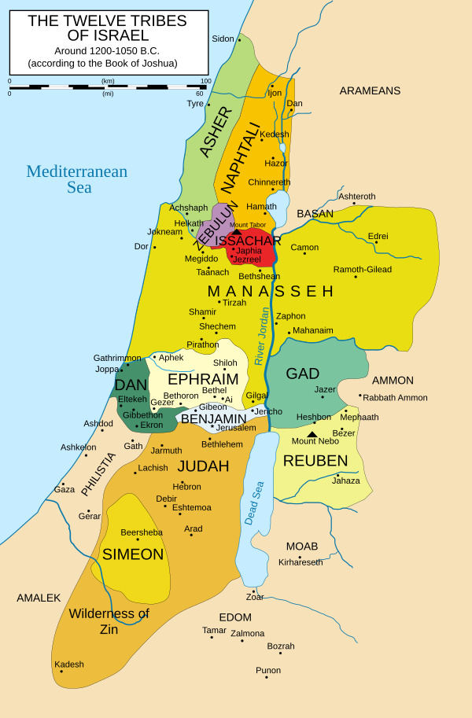

TODO: if it is not describing the land of Israel but rather Nebulae then the mountain and sacrifices may be describing the large Ox Shape above the treasure in the sand.  Dark nebulae rising up likened to smoke rising off the sacrifice.

---

## Reuben
 - Meaning: see a son 
 - 4th month (Noah)
 - 10th month (Moses)
 - Tevet 'muddy month' (Akkadian)
 - December-January
 - Feasts:
 - Leah's 1st son
 - Jacob's 1st son

---

Leah:

> So Leah conceived and bore a son, 
> and she called his name Reuben; 
> for she said, “The LORD has surely seen my affliction. 
> Now therefore, my husband will love me.” 
> Gen 29:32

---

Jacob:

> Reuben, you are my firstborn; 
> My might and the beginning of my strength, 
> Preeminent in dignity and preeminent in power. 
> Uncontrolled as water, you shall not have preeminence, 
> Because you went up to your father’s bed; 
> Then you defiled it — he went up to my couch. 
> Gen 49:3-4

---

Moses:

> May Reuben live and not die, 
> Nor his men be few.  
> Deut 33:6

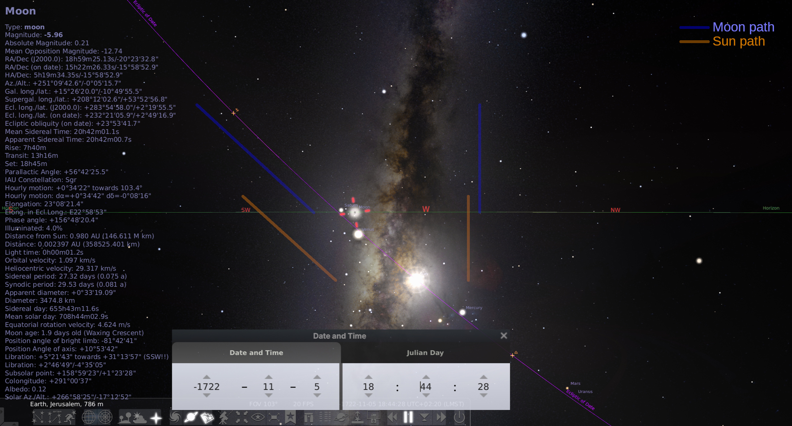

---

## Simeon
 - Meaning: heard
 - 5th month (Noah)
 - 11th month (Moses)
 - Shevat 'strike' heavy rains (Akkadian)
 - Feasts: 
 - Leah's 2nd son
 - Jacob's 2nd son

Leah:

> Then she conceived again and bore a son and said, 
> Because the LORD has heard(שָׁמַע) that I am unloved, 
> He has therefore given me this son also. 
> So she named him Simeon(שִׁמְעוֹן).
> Gen 29:33

---

Jacob:

> Simeon and Levi are brothers; 
> Their swords are implements of violence. 
> Let my soul not enter into their council; 
> Let not my glory be united with their assembly; 
> Because in their anger they slew men, 
> And in their self-will they lamed oxen. 
> Cursed be their anger, for it is fierce; 
> And their wrath, for it is cruel. 
> I will disperse them in Jacob, 
> And scatter them in Israel.
> Gen 49:5-7

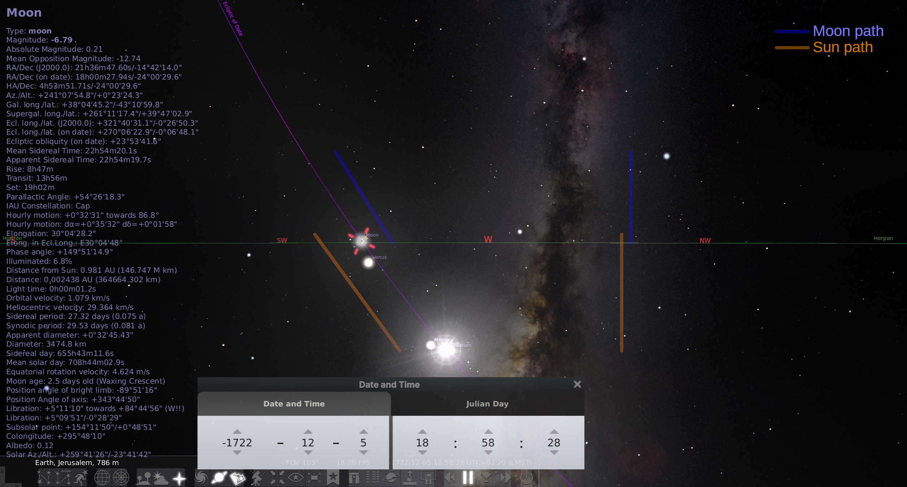

---

## Gad
 - Meaning: troop
 - 6th month (Noah)
 - 12th month (Moses)
 - Adar (Akkadian)
 - Feasts: Purim (lot or cast-lot of Esther)
 - Zilpah Leah's handmaid 1st son
 - Jacob's 7th son

Leah: 

> Then Leah said, “Troop or How-fortunate!”(גָּד)
> So she named him Gad(גָּד). 
> Gen 30:11
---
> גָּ֖ד גְּד֣וּד יְגוּדֶ֑נּוּ וְה֖וּא יָגֻ֥ד עָקֵֽב

---

Jacob:

> As for Gad(גָּ֖ד), raiders(גְּדוּד) shall raid(יְגוּדֶ֑נּוּ) him, 
> But he will raid(יָגֻ֥ד) at their heels.  
> Gen 49:19

---

Moses:

> Of Gad he said, 
> Blessed is the one who enlarges Gad;  
> He lies down as a lion, 
> And tears the arm, also the crown of the head. 
> He provided the first(רֵאשִׁית֙) part for himself, 
> Because a lawgiver’s portion was reserved there. 
> He came with the heads(רָ֣אשֵׁי) of the people; 
> He administered the justice of the Lord, 
> And His judgments with Israel.”  
> Deut 33:20-21

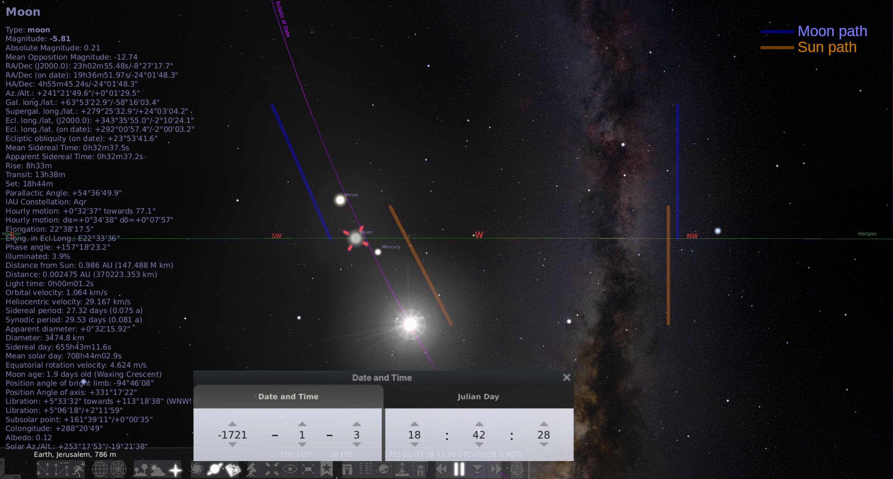
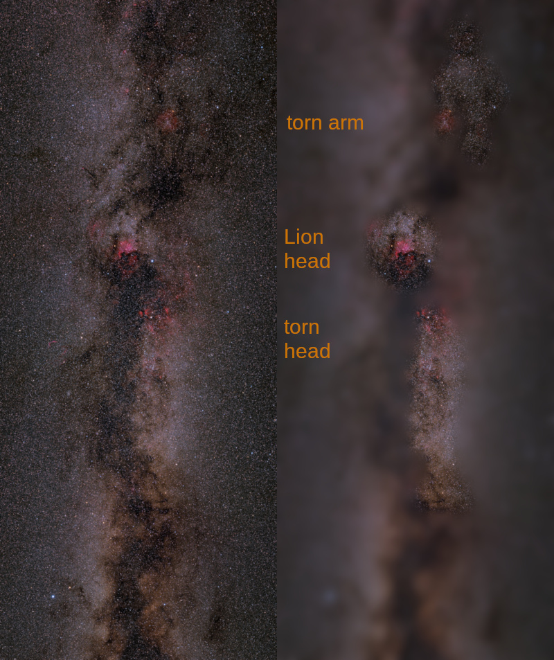

---

## Levi
TODO decide where Levi will fit.
 - Meaning: attached
 -  month (Noah)
 - 13th month (Moses)
 - 
 - Feasts: 
 - Leah's 3rd son
 - Jacob's 3rd son

Leah:

> She conceived again and bore a son and said, 
> Now this time my husband will become-attached-to-me(יִלָּוֶ֤ה), 
> because I have borne him three sons. 
> Therefore he was named Levi(לֵוִֽי).  
> Gen 29:34

---

poetry is matching pairs.

Jacob:

> Simeon and Levi are brothers; 
> Their swords are implements of violence. 
> Let my soul not enter into their council; 
> Let not my glory be united with their assembly; 
> Because in their anger they slew men, 
> And in their self-will they lamed oxen. 
> Cursed be their anger, for it is fierce; 
> And their wrath, for it is cruel. 
> I will disperse them in Jacob, 
> And scatter them in Israel.
> Gen 49:5-7

---

Poetry is matching pairs.

Moses:

> Of Levi he said,  
> Let Your Thummim and Your Urim belong to Your godly man, 
> Whom You proved at Massah, 
> With whom You contended at the waters of Meribah; 
> Who said of his father and his mother, 
> ‘I did not consider them’; 
> And he did not acknowledge his brothers, 
> Nor did he regard his own sons, 
> For they observed Your word, 
> And kept Your covenant. 
> They shall teach Your ordinances to Jacob, 
> And Your law to Israel. 
> They shall put incense before You, 
> And whole burnt offerings on Your altar. 
> O Lord, bless his substance, 
> And accept the work of his hands; 
> Shatter the loins of those who rise up against him, 
> And those who hate him, 
> so that they will not rise again.”  
> Deut 33:8-11

---

## Ephraim
 - Meaning: double fruit 
 - 7th month (Noah)
 - 1st month (Moses)
   - Aviv(אָבִֽיב) 'ear of grain' Exodus 13:4;
   - 'the barly was aviv'  Ex 9:31
   - 'aviv roasted in fire' Lev 2:14
 - Nisan/Nissani 'first fruits' (Akkadian)
 - Araḫ Nissānu 'month of the beginning' (Babylonian)
 - March-April
 - Feasts: Passover, unleavened bread, omer
 - Rachel's 1st => Joseph's 1st son
 - Jacob's 11, Joseph's 1s son

Joseph who saves his family and Egypt from the great famine becomes two tribes: Ephraim and Manesseh. Regarding Joseph we have:

---

Rachel:

> So she conceived and bore a son and said, 
> “God has taken-away(אָסַף) my reproach.” 
> She named him Joseph(יוֹסֵף), saying, 
> May the LORD add-to-me(יֹסֵ֧ף) another son. 
> Gen 30:23-24

---

Jacob:

> Joseph is a fruitful(פָּרָה) bough,
> A fruitful(פָּרָה) bough by a spring; 
> Its branches run over a wall. 
> The archers bitterly attacked him, 
> And shot at him and harassed him; 
> But his bow remained firm, 
> And his arms were agile, 
> From the hands of the Mighty One of Jacob 
> (From there is the Shepherd, the Stone of Israel), 
> From the God of your father who helps you, 
> And by the Almighty who blesses you 
> With blessings of heaven above, 
> Blessings of the deep that lies beneath, 
> Blessings of the breasts and of the womb. 
> The blessings of your father 
> Have surpassed the blessings of my ancestors 
> Up to the utmost bound of the everlasting hills; 
> May they be on the head of Joseph, 
> And on the crown of the head of the one distinguished among his brothers.  
> Gen 49:22-26 

---

Joseph:

> He named the second Ephraim(אֶפְרָ֑יִם), “For,” he said, 
> "God has made me fruitful(פָּרָה) in the land of my affliction." 
> Gen 41:52

---

Jacob/Israel:

> Then Israel stretched out his right hand and laid it on Ephraim’s head, 
> who was the younger, 
> and his left hand on Manasseh’s head, 
> guiding his hands knowingly, 
> for Manasseh was the firstborn. 
> And he blessed Joseph, and said: 
> “God, before whom my fathers Abraham and Isaac walked, 
> The God who has fed me all my life long to this day, 
> The Angel who has redeemed me from all evil, 
> Bless the lads; 
> Let my name be named upon them,  (Ephraim is later called northern Israel) 
> And the name of my fathers Abraham and Isaac; 
> And let them grow into a multitude in the midst of the earth.” 
> 
> Now when Joseph saw that his father laid his right hand on the head of Ephraim, 
> it displeased him; 
> so he took hold of his father’s hand to remove it from Ephraim’s head to Manasseh’s head. 
> And Joseph said to his father, 
> “Not so, my father, 
> for this one is the firstborn; 
> put your right hand on his head.”
> 
> But his father refused and said, 
> “I know, my son, I know. 
> He also shall become a people, 
> and he also shall be great; 
> but truly his younger brother shall be greater than he, 
> and his descendants shall become a multitude of nations.” 
> 
> So he blessed them that day, saying, 
> By you Israel will bless, saying, 
> ‘May God make you as Ephraim and as Manasseh!’ 
> And thus he set Ephraim before Manasseh. 
> Genesis 48

---

Moses:

> Of Joseph he said,  
> Blessed of the LORD be his land, 
> With the choice things of heaven, with the dew, 
> And from the deep lying beneath, 
> And with the choice yield of the sun, 
> And with the choice produce of the moon (months). 
> And with the best things of the ancient mountains, 
> And with the choice things of the everlasting hills, 
> And with the choice things of the land and its fullness, 
> And the favor of Him who dwelt in the bush. 
> Let it come to the head of Joseph, 
> And to the crown of the head of the one distinguished among his brothers. 
> As the firstborn of his ox(שׁוֹר), majesty is his, 
> And his horns are the horns of the wild-ox(רְאֵם); 
> With them he will push the peoples, 
> All at once, to the ends of the earth. 
> And those are the ten-thousands(רְבָבָה) of Ephraim, 
> And those are the thousands(אֶלֶף) of Manasseh.” 
> Deut 33:13-17

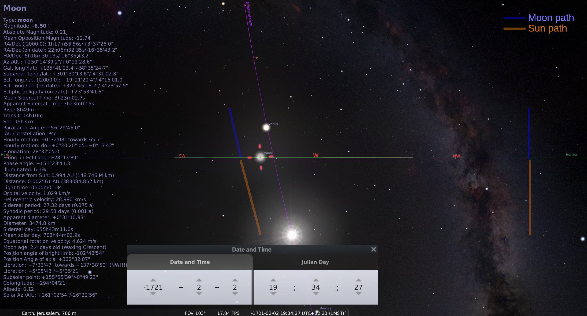

---

## Manasseh
 - Meaning: forget 
 - 8th month (Noah)
 - 2nd month (Moses)
   - Ziv (זו) means 'light', 'glow' 1Kings 6:1, 6:37
 - Iyar (Akkadian)
 - April-May
 - Feasts: 
 - Rachel's 1st => Joseph 2nd son
 - Jacob's 11, Joseph's 2nd son

> Joseph named the firstborn Manasseh, 
> “For,” he said,  
> “God has made me forget all my trouble and all my father’s household.”  
> Gen 41:51

The verses for Joseph are under Ephraim above.

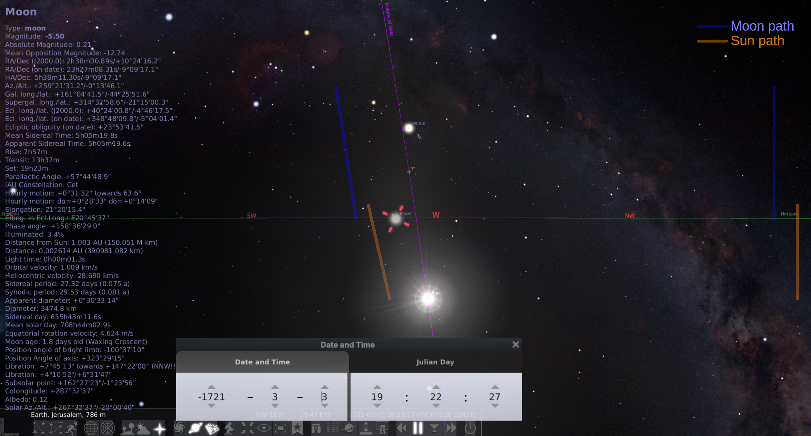

---

## Benjamin
 - Meaning: son of right hand 
 - 9th month (Noah)
 - 3rd month (Moses)
 - Sivan 'season, time' (Akkadian)
 - May-June
 - Feasts: shavout, pentecost
 - Rachel's 2nd
 - Jacob's 12th son

---

Rachel:

> It came about as her soul was departing (for she died), 
> that she named him Ben-oni; 
> but his father called him Benjamin. 
> Gen 35:18

---

Jacob:

> Benjamin is a ravenous wolf; 
> In the morning he devours the prey, 
> And in the evening he divides the spoil.” 
> Gen 49:27

---

Moses:

> Of Benjamin he said,  
> “May the beloved (יְדִיד) of the LORD dwell in security by Him, 
> Who shields him all the day, 
> And he dwells between His shoulders.” 
> Deut 33:12  

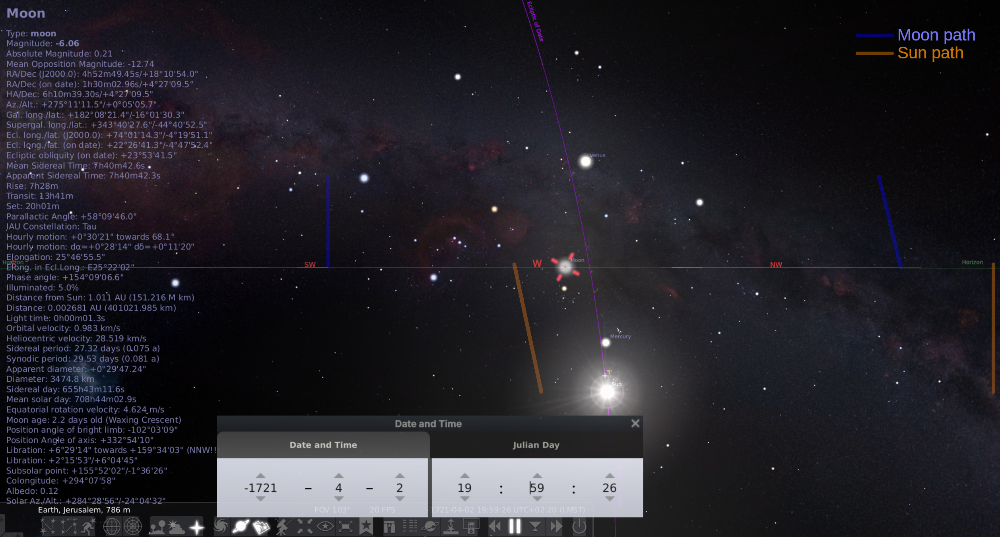

---

## Dan
 - Meaning: judge 
 - 10th month (Noah)
 - 4th month (Moses)
 - Tammuz / Arah Dumuzu diety (Assyrian/Babylonian)
 - June-July
 - Feasts: 
 - Bilhah (Rachel's handmaind) 1st son.
 - Jacob's 5th son

---
Rachel:

> Then Rachel said, 
> “God has vindicated/judged me, 
> and has indeed heard my voice and has given me a son.” 
> Therefore she named him Dan. 
> Gen 30:6

---

Jacob:

> Dan shall judge his people, 
> As one of the tribes of Israel. 
> Dan shall be a serpent in the way, 
> A horned snake in the path, 
> That bites the horse’s heels, 
> So that his rider falls backward. 
> For Your salvation I wait, O LORD. 
> Gen 49:16-18

---

Moses:

> Of Dan he said, 
> Dan is a lion’s whelp, 
> That leaps forth from Bashan. 
> Deut 33:22

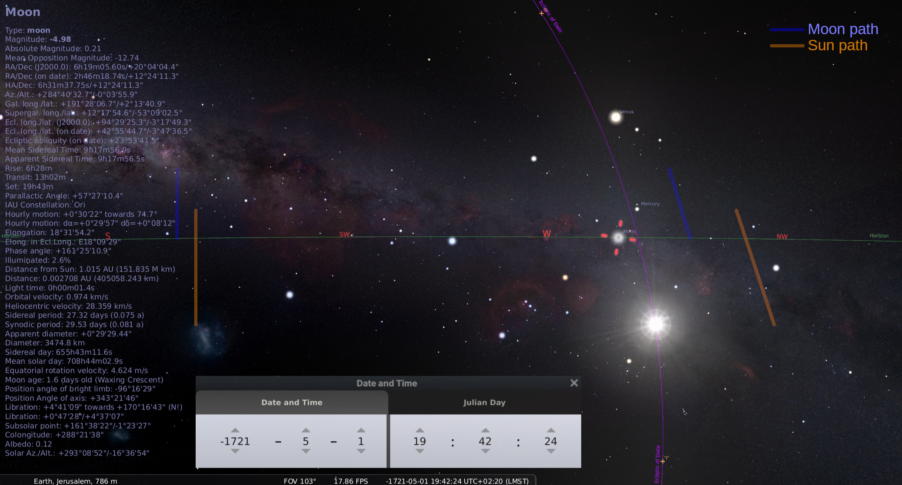

---

## Asher
 - Meaning: happy
 - 11th month (Noah)
 - 5th month (Moses)
 - Av or Abu 'reed' (Akkadian)
 - July-August
 - Feasts: 
 - Zilpah Leah's handmaid 2nd son.
 - Jacob's 8th son

Leah:

> Then Leah said, 
> Happy am I! 
> For women will call me happy. 
> So she named him Asher. 
> Gen 30:13

---

Jacob:

> As for Asher, 
> his food shall be rich, 
> And he will yield royal dainties.  
> Gen 49:20

---

Moses:

> Of Asher he said, 
> More blessed than sons is Asher; 
> May he be favored by his brothers, 
> And may he dip his foot in oil. 
> Your locks will be iron and bronze, 
> And according to your days, 
> so will your leisurely walk be. 
> Deut 33:24-27

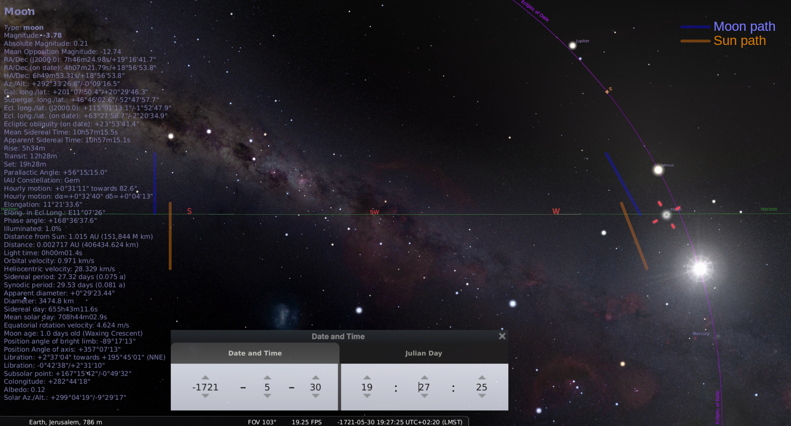

---

## Naphteli
 - Meaning: wrestling
 - 12th month (Noah)
 - 6th month (Moses)
 - Elul 'harvest' (Akkadian)
 - August-September
 - Feasts: 
 - Bilhah Rachel's handmaid 2nd son
 - Jacob's 6th son

Rachel:

> So Rachel said, 
> With mighty wrestlings/twistings 
> I have wrestled/twisted with my sister, 
> and I have indeed prevailed. 
> And she named him Naphtali. 
> Gen 30:8

---

Jacob:

> Naphtali is a doe let loose, 
> He gives beautiful words. 
> Gen 49:21

---

Moses:

> Of Naphtali he said, 
> O Naphtali, satisfied with favor, 
> And full of the blessing of the LORD, 
> Take possession of the sea and the south.  
> Deut 33:23

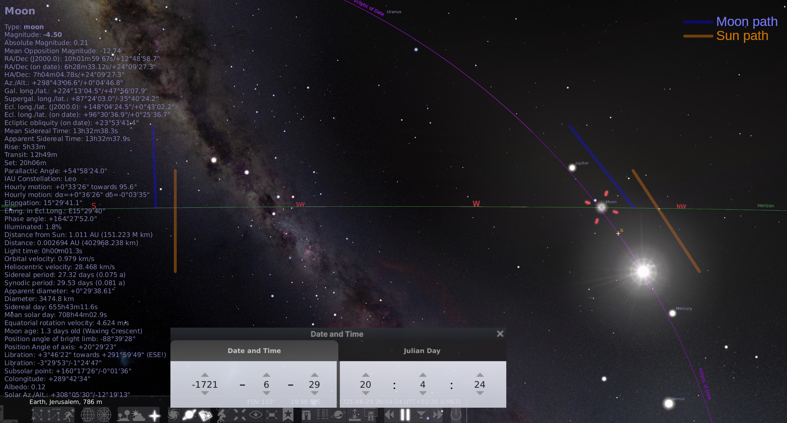

---

## Appendix A
The four apparent lion shapes are demonstrated in
 - [Video 42](https://www.youtube.com/watch?v=nRaLKOOsVmI)
 - [Video 43](https://www.youtube.com/watch?v=D2RI6_u6ArA)
 - [Video 44](https://www.youtube.com/watch?v=S3plw3qRo6o)
 - [Video 45](https://www.youtube.com/watch?v=eICO7esAzQI)

---

## Appendix B

In Hebrew the word for "Mandrakes"(דּוּדַי) is very similar to "beloved"(דּוֹד). It may be the play on the words itself was a mental aphrodisiac rather than a bio-chemical reaction.  I have not found any controlled human trials in relation to Mandragora officinarum or Mandragora autumnalis as an aphrodisiac.  The plant is rich in tropane alkaloids (hyoscyamine, atropine, scopolamine). These are sedative, hallucinogenic, and anticholinergic, which could explain its ancient use as an anesthetic and narcotic. Those effects are not aphrodisiac effects, and anticholinergics can actually impair sexual function.  The gap between a dose that produces effects and a toxic dose is small and unpredictable, since alkaloid content varies by plant part, season, and preparation. Mandrake poisoning is a real medical emergency.  The following passage demonstrates of beloved/love and Mandrake can be a play on words. It is also worth noting that the mandrake was used as a fragrance and it's yellow-to-orange berry has a strong sweet, apple-like scent.

> And your mouth like the best wine! 
> It goes down smoothly for my beloved(דּוֹד), 
> Flowing gently through the lips of those who fall asleep. 
> I am my beloved’s(דּוֹד), And his desire is for me. 
> Come, my beloved(דּוֹד), let us go out into the country, Let us spend the night in the villages. 
> Let us rise early and go to the vineyards; 
> Let us see whether the vine has budded And its blossoms have opened, 
> And whether the pomegranates have bloomed. 
> There I will give you my love(דּוֹד). 
> The mandrakes(דּוּדַי) have given forth fragrance; 
> And over our doors are all choice fruits, Both new and old, Which I have saved up for you, my beloved(דּוֹד).
> Song of Solomon 7:8-13

